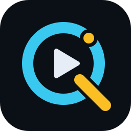
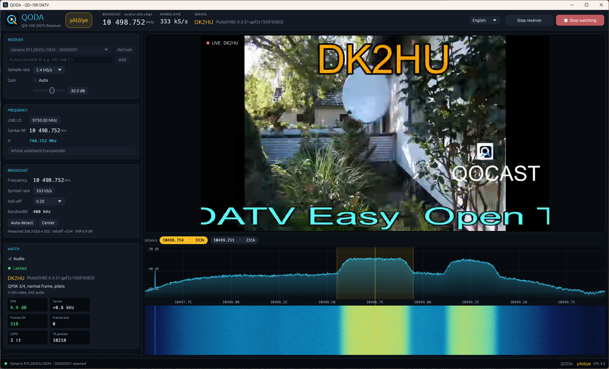
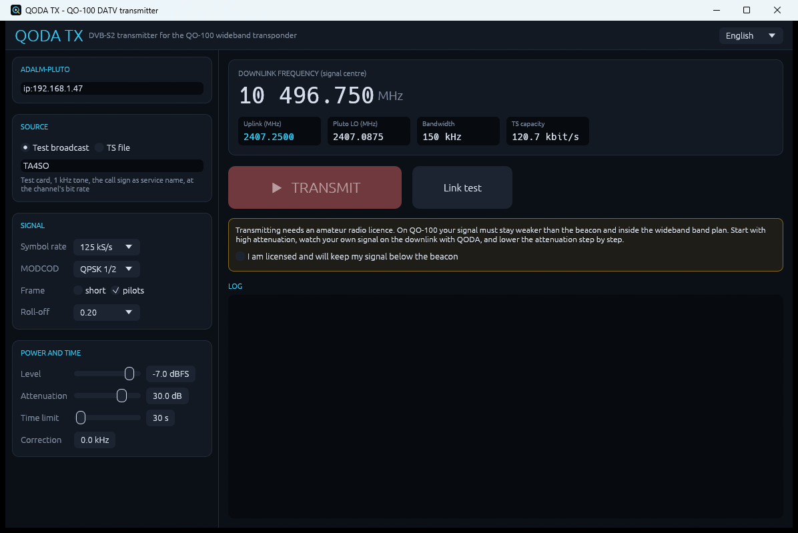
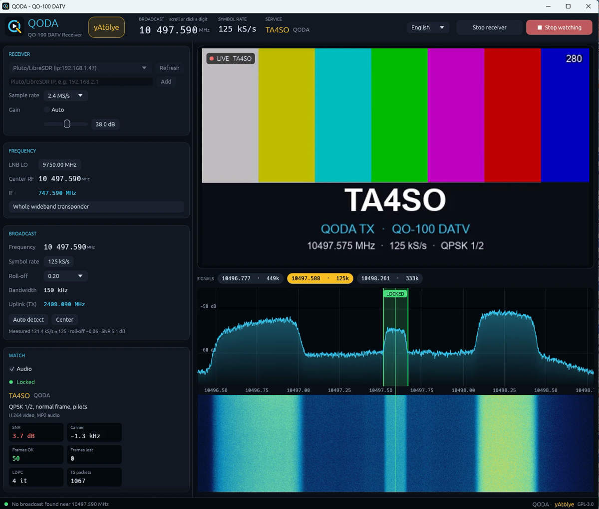

<p align="center"></p>

# QODA

**QODA** is an open-source receiver for the DATV (DVB-S2) broadcasts on the QO-100 satellite, written in Rust. It shows the spectrum, finds the broadcasts in it, decodes the selected one and plays the video, using common SDR receivers.

The name comes from **QO**-100 and **DA**TV.

**[Türkçe açıklama aşağıda ↓](#türkçe)**



## Features

- Works with RTL-SDR, HackRF and other receivers through SoapySDR, and with ADALM-Pluto / LibreSDR directly through libiio (tested with RTL-SDR, HackRF One and LibreSDR over Ethernet)
- Enter the LNB local oscillator and the broadcast frequency; the intermediate frequency is computed and the receiver is tuned automatically
- Live spectrum and waterfall, with a strip of the broadcasts found in the visible band; with a Pluto/LibreSDR on gigabit Ethernet the whole wideband transponder (10491–10499.5 MHz) fits on one screen at 12 MS/s
- Easy tuning: scroll or click individual frequency digits, scroll to move the selection, drag the spectrum to move the receiver
- Automatic detection of the symbol rate, bandwidth and roll-off of a broadcast from the spectrum
- A DVB-S2 decoder written from scratch in Rust, based on ETSI EN 302 307-1: frame sync, carrier and timing recovery, MODCOD (modulation and FEC) read from the frame header, parallel LDPC and BCH decoding, MPEG-TS output
- Video shown inside the program, with audio
- Service name, provider and stream types read from the DVB tables
- Raw IQ recording in SigMF format, and a command-line tool to decode recordings
- English and Turkish user interface

QPSK, 8PSK and 16APSK broadcasts are supported, with or without pilots, in normal or short frames. 8PSK and 16APSK are verified with synthetic DVB-S2 signals; no such broadcast was on air while testing. 32APSK and BCH error correction are not implemented yet.

## Installing on Windows

1. Download one of the two zips from the releases page and extract it anywhere:
   - `QODA-<version>-windows-x64-ffmpeg.zip` includes FFmpeg; nothing else to install.
   - `QODA-<version>-windows-x64.zip` is smaller and uses an FFmpeg installed on the system. Install it for video and audio with `winget install Gyan.FFmpeg`.
2. Run `qoda.exe`.

The package already contains SoapySDR with the RTL-SDR and HackRF drivers and libiio for Pluto/LibreSDR; nothing else needs to be installed. USB receivers need their usual Windows USB driver (for an RTL-SDR, WinUSB installed with Zadig). If a receiver is not found, `qoda.exe --diagnose > diag.txt` writes what the program sees.

The package is built with `tools/windows/package.ps1`.

## Installing on Linux

On Ubuntu 24.04 or newer, Debian 13 and derivatives, download `qoda_<version>_amd64.deb` from the releases page and install it; apt also installs SoapySDR, the RTL-SDR and HackRF modules, libiio and FFmpeg:

```bash
sudo apt install ./qoda_<version>_amd64.deb
```

QODA then appears in the application menu, and USB receivers work without root. For other distributions, `QODA-<version>-linux-x86_64.tar.gz` holds the program; install SoapySDR, libiio and FFmpeg with your package manager (see `INSTALL.txt` inside).

To build from source on Debian/Ubuntu:

```bash
sudo apt install build-essential pkg-config libclang-dev libsoapysdr-dev \
  soapysdr-module-rtlsdr soapysdr-module-hackrf libiio0 ffmpeg \
  libxkbcommon-dev libwayland-dev libx11-dev libxcursor-dev libxrandr-dev libxi-dev libgl1-mesa-dev
cargo build --release
./target/release/qoda
```

Install Rust with [rustup](https://rustup.rs/) if needed. For an RTL-SDR, the kernel's DVB-T driver must not claim the stick: if `SoapySDRUtil --find` does not show it, blacklist `dvb_usb_rtl28xxu` (`echo blacklist dvb_usb_rtl28xxu | sudo tee /etc/modprobe.d/rtlsdr.conf`) and replug it. Pluto/LibreSDR use `libiio0`.

## Installing on macOS

macOS is not tested with hardware yet; it builds in CI on Apple Silicon. Install [Homebrew](https://brew.sh/) and [Rust](https://rustup.rs/), then:

```bash
brew install pkg-config soapysdr soapyrtlsdr soapyhackrf ffmpeg
cargo build --release
./target/release/qoda
```

For a Pluto or LibreSDR, install libiio from the [Analog Devices releases](https://github.com/analogdevicesinc/libiio/releases) (`iio.framework`).

## Requirements

- A dish pointed at QO-100, an LNB (horizontal polarisation, 18 V) and an SDR receiver. QO-100 DATV broadcasts are usually 1.5 MS/s or less, so even an RTL-SDR is enough.
- [SoapySDR](https://github.com/pothosware/SoapySDR) and the driver module for your receiver. On Windows the easiest way is [PothosSDR](https://downloads.myriadrf.org/builds/PothosSDR/); add its `bin` folder to `PATH`.
- [FFmpeg](https://ffmpeg.org/) for video and audio (`ffmpeg` and `ffplay` in `PATH`). On Windows: `winget install Gyan.FFmpeg`.

**Note for RTL-SDR on Windows:** the old `rtlsdr.dll` that comes with PothosSDR 2021 can crash when the stream is stopped. Copy `rtlsdr.dll`, `pthreadVC2.dll` and `msvcr100.dll` from the `x64` folder of a [RTL-SDR Blog release](https://github.com/rtlsdrblog/rtl-sdr-blog/releases) next to `qoda.exe`.

## Building

```bash
cargo build --release
```

The program is `target/release/qoda`, the command-line tool is `target/release/qoda-analyze`.

## Usage

1. Select the device and press **Start receiver**. For a Pluto or LibreSDR on the network, type its IP address under the device list and press **Add**; it is remembered.
2. Enter the **LNB LO** (e.g. 9750 MHz) and the **Center RF** frequency; the IF is shown below them.
3. Click a broadcast in the spectrum, or pick one from the **Signals** strip above it. Its symbol rate and roll-off are detected and the occupied band is highlighted. Double-click centers the receiver on it.
4. Press **▶ Watch**. The broadcast is decoded live; the video appears above the spectrum and the **Watch** card shows the lock state, MODCOD, SNR, frame counters and the service name.

Tuning:

- In the frequency displays, scroll over a digit to change that digit; clicking its upper half increases it, the lower half decreases it.
- In the spectrum, the mouse wheel moves the selection by 10 kHz (100 kHz with Shift); dragging moves the receiver.
- While watching, the decoder restarts with the new settings half a second after you stop changing them.

The interface language can be changed from the selector at the top right. The language and the LNB LO are saved in `%APPDATA%\QODA\settings.txt` (on Linux `~/.config/qoda/settings.txt`).

### Recordings

**Record IQ** saves the raw samples as SigMF (`.sigmf-data` and `.sigmf-meta`) in the `recordings` folder. A recording can be decoded offline:

```bash
qoda-analyze recordings/<name>
```

`--scan` lists every broadcast in the recording; `--freq MHz` picks one that is not at the center. It prints the detected parameters, every frame header, the error-correction results and the service information, and writes the transport stream next to the recording as a `.ts` file. Options: `--seconds S`, `--rs kS/s`, `--rolloff R`, `--stream` (decode with the same streaming receiver as the live view) and `--noise dB` (add white noise to test weak-signal reception).

## Transmitting (experimental)

`qoda-tx` is a DVB-S2 modulator for licensed radio amateurs. It turns an MPEG-TS file, or a test broadcast it makes with FFmpeg, into DVB-S2 and either writes a SigMF recording or transmits it on the QO-100 wideband uplink with an ADALM-Pluto.

You need an amateur radio licence. On QO-100 your signal must stay weaker than the beacon and inside the wideband band plan.

### QODA TX: your first transmission

**QODA TX** (`qoda-tx-gui`) is the transmitter in a window. It was tested with an ADALM-Pluto (firmware 0.25, over Ethernet), a 4 W PA and a 2 m dish: the test broadcast at 125 and 66 kS/s QPSK 1/2 went through QO-100 and QODA decoded it without losing a frame.



1. **ADALM-PLUTO**: the Pluto's address, e.g. `192.168.2.1` (or `usb:`). Close SDR-Console or any other program using it first.
2. **SOURCE**: *Test broadcast* with your call sign (colour bars, the call sign, frequency and mode, a frame counter and a 1 kHz tone, made with FFmpeg at the channel's exact bit rate), or a *TS file* of your own. A file must be muxed at the TS capacity shown on the right; QODA TX measures it and says so if not.
3. **Frequency**: the downlink frequency of the signal's centre; the uplink, the Pluto's LO and the bandwidth follow. Pick a free spot in the transponder; QODA TX refuses frequencies whose signal would leave the band.
4. **SIGNAL**: start with **125 kS/s, QPSK 1/2**. With a few watts, a lower symbol rate gives a stronger signal (66 kS/s is 2.7 dB stronger than 125), a higher one a better picture.
5. **Link test** sends the signal to the Pluto at the real rate with the transmitter off: the log shows the Pluto's settings and the rate the link achieves. Nothing is radiated.
6. **POWER AND TIME**: leave the attenuation at 30 dB for the first try. Tick the confirmation, press **TRANSMIT** and watch your signal in QODA (another receiver on the downlink). Lower the attenuation step by step until QODA decodes it with some margin, keeping the signal below the beacon. **STOP**, the time limit or closing the window switch the transmitter off.

In QODA, click your signal and press **Watch**: the symbol rate and the frequency are found by themselves (automatic frequency correction).



If the picture stops while QODA TX still shows ON AIR, switch the Pluto and the PA off and on: a PA that switches to transmit by sensing RF can hang after many short transmissions.

### qoda-tx on the command line

Check the signal without transmitting; QODA's own decoder reads it back:

```bash
qoda-tx --pattern <CALLSIGN> --out test --rs 333 --modcod "QPSK 1/2"
qoda-analyze test --stream
```

Transmit (the downlink frequency of the signal's centre is given, the uplink is derived from it):

```bash
qoda-tx --pattern <CALLSIGN> --pluto ip:192.168.2.1 --freq 10497.75 --rs 333 --modcod "QPSK 1/2" --atten 30 --seconds 30
```

- `--pattern CALLSIGN` makes a 20 s test card with a 1 kHz tone and the call sign as the service name, muxed at the channel's exact bit rate; it repeats while transmitting. Or give a `.ts` file instead.
- The whole signal must lie inside the uplink band, 2401.5–2409.5 MHz; otherwise `qoda-tx` refuses.
- `--atten dB` is the Pluto's output attenuation (default 30 dB, 0–89.75). Start high, watch your own signal on the downlink with QODA and lower it step by step; keep the signal below the beacon and the PA out of compression.
- `--level dBFS` is the RMS level of the samples sent to the Pluto (default −7, at most −4, where the peaks start to clip). A higher level gives more power and makes the Pluto's LO leakage (a carrier in the middle of the signal) smaller relative to the signal.
- The Pluto leaks some of its LO, which would sit as a carrier in the middle of the signal. `qoda-tx` therefore tunes the LO below the signal and moves the signal up digitally (by 1.5 × half the bandwidth + 50 kHz, e.g. 162.5 kHz at 125 kS/s), so the leakage lands beside it. `--shift kHz` changes the distance, `--shift 0` turns it off.
- `--offset kHz` corrects the Pluto's oscillator error, `--seconds S` limits the time on air (default 30, at most 600). Ctrl+C switches the transmitter off.
- `--loopback` sends the samples at the real rate through the AD9361's digital loopback with the transmitter off: it checks, without radiating anything, that the link to the Pluto keeps up (`qoda-tx` prints the rate it achieves and warns when it falls short; 333 kS/s needs about 75 Mbit/s).
- On Windows PowerShell, run the programs in the current folder as `.\qoda-tx.exe`.
- Other options: `--short`, `--no-pilots`, `--rolloff R`, `--sps N`.

## How it works

```
SDR ─► DC blocker ─► frequency shift ─► decimation ─► RRC matched filter ─► Gardner timing ─► PL header sync (SOF + PLS)
    ─► descrambling + carrier PLL ─► soft demap + bit deinterleaver ─► LDPC (parallel) ─► BCH ─► BBFRAME ─► MPEG-TS
    ─► ffmpeg (video) / ffplay (audio)
```

The LDPC tables and BCH polynomials were generated from the text of the standard with `tools/gen_ldpc_tables.py`; the PDF of the standard is not included in the repository.

## License

GPL-3.0-or-later. See [LICENSE](LICENSE).

## Credits

QODA is developed by the **yAtölye** (yeniden atölye) working group.

---

## Türkçe

**QODA**, QO-100 uydusundaki DATV (DVB-S2) yayınlarını izlemek için Rust ile yazılmış açık kaynak bir alıcıdır. Yaygın SDR alıcılarla spektrumu gösterir, içindeki yayınları bulur, seçilen yayını çözer ve videoyu oynatır.

Adı **QO**-100 ve **DA**TV'den gelir.


### Özellikler

- RTL-SDR, HackRF ve diğer alıcılarla SoapySDR üzerinden, ADALM-Pluto / LibreSDR ile doğrudan libiio üzerinden çalışır (RTL-SDR, HackRF One ve Ethernet üzerinden LibreSDR ile denendi)
- LNB lokal osilatörü ve yayın frekansı girilir; ara frekans hesaplanır ve alıcı otomatik ayarlanır
- Canlı spektrum ve şelale, görünen banttaki yayınların listelendiği bir şerit; gigabit Ethernet'teki Pluto/LibreSDR ile 12 MS/s'de geniş bant transponderinin (10491–10499.5 MHz) tamamı tek ekranda
- Kolay ayar: frekans rakamlarını tek tek tekerlekle ya da tıklayarak değiştirme, tekerlekle seçimi kaydırma, spektrumu sürükleyerek alıcıyı kaydırma
- Yayının sembol hızı, bant genişliği ve roll-off'unun spektrumdan otomatik tespiti
- ETSI EN 302 307-1 temel alınarak Rust ile sıfırdan yazılmış DVB-S2 çözücü: çerçeve senkronu, taşıyıcı ve zamanlama kurtarma, çerçeve başlığından MODCOD (modülasyon ve FEC), paralel LDPC ve BCH çözümü, MPEG-TS çıkışı
- Program içinde video ve ses
- DVB tablolarından servis adı, sağlayıcı ve akış türleri
- SigMF biçiminde ham IQ kaydı ve kayıtları çözen komut satırı aracı
- İngilizce ve Türkçe arayüz

QPSK, 8PSK ve 16APSK yayınlar destekleniyor (pilotlu/pilotsuz, normal/kısa çerçeve). 8PSK ve 16APSK sentetik DVB-S2 sinyalleriyle doğrulandı; testler sırasında yayında böyle bir istasyon yoktu. 32APSK ve BCH hata düzeltme henüz yok.

### Windows'ta kurulum

1. Sürümler sayfasından iki zip'ten birini indirip istediğiniz bir yere açın:
   - `QODA-<sürüm>-windows-x64-ffmpeg.zip` FFmpeg'i içerir; başka bir şey kurmanız gerekmez.
   - `QODA-<sürüm>-windows-x64.zip` daha küçüktür ve sistemde kurulu FFmpeg'i kullanır. Video ve ses için kurun: `winget install Gyan.FFmpeg`.
2. `qoda.exe`'yi çalıştırın.

Paket, RTL-SDR ve HackRF sürücüleriyle SoapySDR'ı ve Pluto/LibreSDR için libiio'yu zaten içerir; başka bir şey kurmak gerekmez. USB alıcılar için Windows'un olağan USB sürücüsü gerekir (RTL-SDR için Zadig ile kurulan WinUSB). Bir alıcı bulunamazsa `qoda.exe --diagnose > tani.txt` programın gördüklerini yazar.

Paket `tools/windows/package.ps1` ile oluşturulur.

### Linux'ta kurulum

Ubuntu 24.04 ve üstü, Debian 13 ve bunlara dayanan dağıtımlarda sürümler sayfasından `qoda_<sürüm>_amd64.deb` dosyasını indirip kurun; apt SoapySDR'ı, RTL-SDR ve HackRF modüllerini, libiio'yu ve FFmpeg'i de kurar:

```bash
sudo apt install ./qoda_<sürüm>_amd64.deb
```

QODA uygulama menüsünde görünür ve USB alıcılar root olmadan çalışır. Diğer dağıtımlar için `QODA-<sürüm>-linux-x86_64.tar.gz` programı içerir; SoapySDR, libiio ve FFmpeg'i paket yöneticinizle kurun (içindeki `INSTALL.txt`'ye bakın).

Debian/Ubuntu'da kaynaktan derlemek için:

```bash
sudo apt install build-essential pkg-config libclang-dev libsoapysdr-dev \
  soapysdr-module-rtlsdr soapysdr-module-hackrf libiio0 ffmpeg \
  libxkbcommon-dev libwayland-dev libx11-dev libxcursor-dev libxrandr-dev libxi-dev libgl1-mesa-dev
cargo build --release
./target/release/qoda
```

Rust yoksa [rustup](https://rustup.rs/) ile kurun. RTL-SDR'ı çekirdeğin DVB-T sürücüsü sahiplenmemeli: `SoapySDRUtil --find` onu göstermiyorsa `dvb_usb_rtl28xxu`'yu engelleyin (`echo blacklist dvb_usb_rtl28xxu | sudo tee /etc/modprobe.d/rtlsdr.conf`) ve alıcıyı çıkarıp takın. Pluto/LibreSDR `libiio0` kullanır.

### macOS'ta kurulum

macOS henüz gerçek alıcıyla denenmedi; CI'da Apple Silicon üzerinde derleniyor. [Homebrew](https://brew.sh/) ve [Rust](https://rustup.rs/) kurduktan sonra:

```bash
brew install pkg-config soapysdr soapyrtlsdr soapyhackrf ffmpeg
cargo build --release
./target/release/qoda
```

Pluto veya LibreSDR için libiio'yu [Analog Devices sürümlerinden](https://github.com/analogdevicesinc/libiio/releases) (`iio.framework`) kurun.

### Gereksinimler

- QO-100'e bakan bir çanak, LNB (yatay polarizasyon, 18 V) ve bir SDR alıcı. QO-100 DATV yayınları genelde 1.5 MS/s ve altında olduğu için RTL-SDR bile yeterli.
- [SoapySDR](https://github.com/pothosware/SoapySDR) ve alıcınızın sürücü modülü. Windows'ta en kolayı [PothosSDR](https://downloads.myriadrf.org/builds/PothosSDR/); `bin` klasörünü `PATH`'e ekleyin.
- Video ve ses için [FFmpeg](https://ffmpeg.org/) (`ffmpeg` ve `ffplay` `PATH`'te). Windows'ta: `winget install Gyan.FFmpeg`.

**Windows'ta RTL-SDR için not:** PothosSDR 2021 ile gelen eski `rtlsdr.dll` akış durdurulurken çökebiliyor. [RTL-SDR Blog sürümlerinden](https://github.com/rtlsdrblog/rtl-sdr-blog/releases) `x64` klasöründeki `rtlsdr.dll`, `pthreadVC2.dll` ve `msvcr100.dll` dosyalarını `qoda.exe`'nin yanına koyun.

### Derleme

```bash
cargo build --release
```

Program `target/release/qoda`, komut satırı aracı `target/release/qoda-analyze`'dır.

### Kullanım

1. Cihazı seçip **Alıcıyı başlat**'a basın. Ağdaki bir Pluto veya LibreSDR için cihaz listesinin altına IP adresini yazıp **Ekle**'ye basın; adres hatırlanır.
2. **LNB LO** (ör. 9750 MHz) ve **Merkez RF** frekansını girin; ara frekans altlarında görünür.
3. Spektrumda bir yayına tıklayın ya da üstteki **Yayınlar** şeridinden birini seçin. Sembol hızı ve roll-off tespit edilir, kapladığı bant vurgulanır. Çift tıklama alıcıyı o yayına ortalar.
4. **▶ İzle**'ye basın. Yayın canlı olarak çözülür; video spektrumun üstünde görünür, **İzleme** kartında kilit durumu, MODCOD, SNR, çerçeve sayaçları ve servis adı gösterilir.

Ayar:

- Frekans göstergelerinde bir rakamın üzerinde tekerlek o rakamı değiştirir; rakamın üst yarısına tıklamak artırır, alt yarısı azaltır.
- Spektrumda tekerlek seçimi 10 kHz (Shift ile 100 kHz) kaydırır; sürüklemek alıcıyı kaydırır.
- İzlerken çözücü, ayarları değiştirmeyi bıraktıktan yarım saniye sonra yeni ayarla yeniden başlar.

Arayüz dili sağ üstteki seçiciden değiştirilir. Dil ve LNB LO `%APPDATA%\QODA\settings.txt` (Linux'ta `~/.config/qoda/settings.txt`) dosyasında saklanır.

#### Kayıtlar

**IQ kaydet** ham örnekleri `recordings` klasörüne SigMF (`.sigmf-data` ve `.sigmf-meta`) olarak kaydeder. Kayıt çevrimdışı çözülebilir:

```bash
qoda-analyze recordings/<ad>
```

`--scan` kayıttaki bütün yayınları listeler; `--freq MHz` ortada olmayan bir yayını seçer. Tespit edilen parametreleri, her çerçeve başlığını, hata düzeltme sonuçlarını ve servis bilgisini yazdırır, taşıma akışını kaydın yanına `.ts` dosyası olarak yazar. Seçenekler: `--seconds S`, `--rs kS/s`, `--rolloff R`, `--stream` (canlı görünümdekiyle aynı akış alıcısıyla çöz) ve `--noise dB` (zayıf sinyal alımını sınamak için beyaz gürültü ekle).

### Yayın yapma (deneysel)

`qoda-tx`, lisanslı radyo amatörleri için bir DVB-S2 modülatörüdür. Bir MPEG-TS dosyasını ya da FFmpeg ile kendi ürettiği test yayınını DVB-S2'ye çevirir; SigMF kaydı olarak yazar ya da ADALM-Pluto ile QO-100 geniş bant uplink'inde yayınlar.

Amatör telsiz lisansı gerekir. QO-100'de sinyaliniz beacondan zayıf kalmalı ve geniş bant bant planına uymalıdır.

#### QODA TX ile ilk yayın

**QODA TX** (`qoda-tx-gui`) vericinin pencereli halidir. ADALM-Pluto (yazılım 0.25, Ethernet üzerinden), 4 W'lık bir amplifikatör ve 2 m'lik çanakla denendi: 125 ve 66 kS/s QPSK 1/2 test yayını QO-100'den geçti ve QODA tek çerçeve kaybetmeden çözdü.


1. **ADALM-PLUTO**: Pluto'nun adresi, ör. `192.168.2.1` (ya da `usb:`). Önce SDR-Console'u ya da Pluto'yu kullanan başka programı kapatın.
2. **KAYNAK**: Çağrı işaretinizle *Test yayını* (renk çubukları, çağrı işareti, frekans ve mod, kare sayacı ve 1 kHz ton; FFmpeg ile kanalın tam bit hızında üretilir) ya da kendi *TS dosyanız*. Dosya, sağda görünen TS kapasitesinde paketlenmiş olmalıdır; QODA TX bunu ölçer, uymuyorsa söyler.
3. **Frekans**: sinyal merkezinin downlink frekansı; uplink, Pluto osilatörü ve bant genişliği ondan hesaplanır. Transponderde boş bir yer seçin; sinyali bandın dışına taşacak frekansları QODA TX reddeder.
4. **SİNYAL**: **125 kS/s, QPSK 1/2** ile başlayın. Birkaç watt'la düşük sembol hızı daha güçlü sinyal verir (66 kS/s, 125'ten 2,7 dB güçlüdür), yüksek sembol hızı daha iyi görüntü.
5. **Bağlantı testi** sinyali gerçek hızda, verici kapalıyken Pluto'ya gönderir: günlükte Pluto'nun ayarları ve bağlantının ulaştığı hız görünür. Hiçbir şey yayılmaz.
6. **GÜÇ VE SÜRE**: İlk denemede zayıflatmayı 30 dB'de bırakın. Onayı işaretleyip **YAYINLA**'ya basın ve sinyalinizi QODA'da (downlink'teki başka bir alıcıda) izleyin. Zayıflatmayı, QODA biraz payla çözene kadar adım adım düşürün; sinyal beacondan zayıf kalsın. **DURDUR**, süre sınırı ya da pencerenin kapatılması vericiyi kapatır.

QODA'da sinyalinize tıklayıp **İzle**'ye basın: sembol hızı ve frekans kendiliğinden bulunur (otomatik frekans düzeltmesi).


QODA TX "YAYINDA" gösterirken görüntü gelmiyorsa Pluto'yu ve amplifikatörü kapatıp açın: RF algılayarak yayına geçen amplifikatörler, art arda çok sayıda kısa yayından sonra takılı kalabiliyor.

#### Komut satırında qoda-tx

Sinyali yayın yapmadan kontrol edin; QODA'nın kendi çözücüsü geri okur:

```bash
qoda-tx --pattern <ÇAĞRI-İŞARETİ> --out test --rs 333 --modcod "QPSK 1/2"
qoda-analyze test --stream
```

Yayın (sinyal merkezinin downlink frekansı verilir, uplink ondan hesaplanır):

```bash
qoda-tx --pattern <ÇAĞRI-İŞARETİ> --pluto ip:192.168.2.1 --freq 10497.75 --rs 333 --modcod "QPSK 1/2" --atten 30 --seconds 30
```

- `--pattern ÇAĞRI-İŞARETİ` 1 kHz tonlu, servis adı çağrı işareti olan 20 saniyelik bir test kartı üretir; kanalın tam bit hızında paketlenir ve yayın boyunca tekrarlanır. Onun yerine bir `.ts` dosyası da verilebilir.
- Sinyalin tamamı 2401,5–2409,5 MHz uplink bandının içinde olmalıdır; değilse `qoda-tx` yayını reddeder.
- `--atten dB` Pluto'nun çıkış zayıflatmasıdır (varsayılan 30 dB, 0–89,75). Yüksekten başlayın, kendi sinyalinizi QODA ile downlink'te izleyerek adım adım düşürün; sinyal beacondan zayıf kalsın, amplifikatör doyuma girmesin.
- `--level dBFS` Pluto'ya gönderilen örneklerin RMS seviyesidir (varsayılan −7, en fazla −4; üstünde tepeler kırpılır). Daha yüksek seviye daha fazla güç verir ve Pluto'nun taşıyıcı sızıntısını (sinyalin ortasındaki tepe) sinyale göre küçültür.
- Pluto osilatörünün bir kısmını sızdırır; bu, sinyalin ortasında bir taşıyıcı olarak görünürdü. Bu yüzden `qoda-tx` osilatörü sinyalin altına ayarlar ve sinyali dijital olarak yukarı kaydırır (yarım bant genişliğinin 1,5 katı + 50 kHz, ör. 125 kS/s'de 162,5 kHz); sızıntı sinyalin yanına düşer. `--shift kHz` mesafeyi değiştirir, `--shift 0` kapatır.
- `--offset kHz` Pluto'nun osilatör hatasını düzeltir, `--seconds S` yayın süresini sınırlar (varsayılan 30, en fazla 600). Ctrl+C vericiyi kapatır.
- `--loopback` örnekleri gerçek hızda, verici kapalıyken AD9361'in dijital geri döngüsünden geçirir: Pluto bağlantısının yetip yetmediğini hiçbir şey yaymadan sınar (`qoda-tx` ulaşılan hızı yazar, yetmezse uyarır; 333 kS/s için yaklaşık 75 Mbit/s gerekir).
- Windows PowerShell'de bulunduğunuz klasördeki programları `.\qoda-tx.exe` şeklinde çalıştırın.
- Diğer seçenekler: `--short`, `--no-pilots`, `--rolloff R`, `--sps N`.

### Nasıl çalışır

```
SDR ─► DC engelleme ─► frekans kaydırma ─► seyreltme ─► RRC eşleştirilmiş filtre ─► Gardner zamanlama ─► PL başlık senkronu (SOF + PLS)
    ─► karıştırma çözümü + taşıyıcı PLL ─► yumuşak demap + bit karıştırıcı çözümü ─► LDPC (paralel) ─► BCH ─► BBFRAME ─► MPEG-TS
    ─► ffmpeg (video) / ffplay (ses)
```

LDPC tabloları ve BCH polinomları standardın metninden `tools/gen_ldpc_tables.py` ile üretildi; standardın PDF'i repoda yer almaz.

### Lisans

GPL-3.0-or-later. Ayrıntılar için [LICENSE](LICENSE).

### Katkıda bulunanlar

QODA, **yAtölye** (yeniden atölye) çalışma grubu tarafından geliştirilmektedir.
