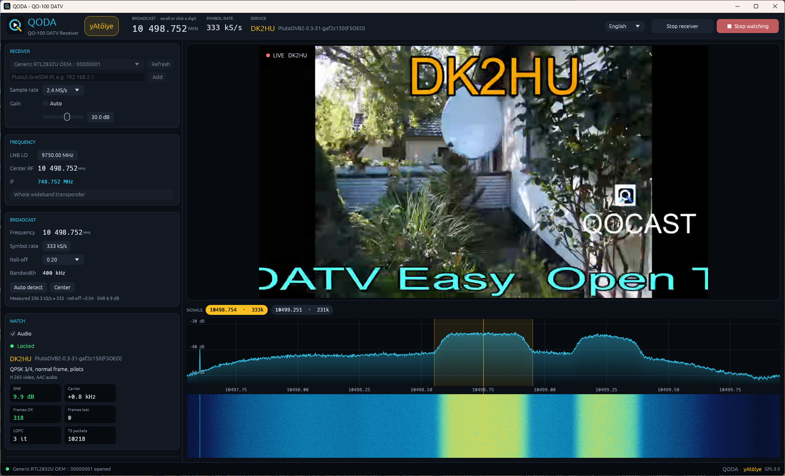

<p align="center"></p>

# QODA

**QODA** is an open-source receiver for the DATV (DVB-S2) broadcasts on the QO-100 satellite, written in Rust. It shows the spectrum, finds the broadcasts in it, decodes the selected one and plays the video, using common SDR receivers.

The name comes from **QO**-100 and **DA**TV.

[Türkçe](README.tr.md)



## Features

- Works with RTL-SDR, HackRF and other receivers through SoapySDR, and with ADALM-Pluto / LibreSDR directly through libiio (tested with RTL-SDR, HackRF One and LibreSDR over Ethernet)
- Enter the LNB local oscillator and the broadcast frequency; the intermediate frequency is computed and the receiver is tuned automatically
- Live spectrum and waterfall, with a strip of the broadcasts found in the visible band; with a Pluto/LibreSDR on gigabit Ethernet the whole wideband transponder (10491–10499.5 MHz) fits on one screen at 12 MS/s
- Easy tuning: scroll or click individual frequency digits, scroll to move the selection, drag the spectrum to move the receiver
- Automatic detection of the symbol rate, bandwidth and roll-off of a broadcast from the spectrum
- A DVB-S2 decoder written from scratch in Rust, based on ETSI EN 302 307-1: frame sync, carrier and timing recovery, MODCOD (modulation and FEC) read from the frame header, parallel LDPC and BCH decoding, MPEG-TS output
- Video shown inside the program, with audio
- Service name, provider and stream types read from the DVB tables
- Raw IQ recording in SigMF format, and a command-line tool to decode recordings
- English and Turkish user interface

QPSK, 8PSK and 16APSK broadcasts are supported, with or without pilots, in normal or short frames. 8PSK and 16APSK are verified with synthetic DVB-S2 signals; no such broadcast was on air while testing. 32APSK and BCH error correction are not implemented yet.

## Installing on Windows

1. Download one of the two zips from the releases page and extract it anywhere:
   - `QODA-<version>-windows-x64-ffmpeg.zip` includes FFmpeg; nothing else to install.
   - `QODA-<version>-windows-x64.zip` is smaller and uses an FFmpeg installed on the system. Install it for video and audio with `winget install Gyan.FFmpeg`.
2. Run `qoda.exe`.

The package already contains SoapySDR with the RTL-SDR and HackRF drivers and libiio for Pluto/LibreSDR; nothing else needs to be installed. USB receivers need their usual Windows USB driver (for an RTL-SDR, WinUSB installed with Zadig). If a receiver is not found, `qoda.exe --diagnose > diag.txt` writes what the program sees.

The package is built with `tools/windows/package.ps1`.

## Installing on Linux

On Ubuntu 24.04 or newer, Debian 13 and derivatives, download `qoda_<version>_amd64.deb` from the releases page and install it; apt also installs SoapySDR, the RTL-SDR and HackRF modules, libiio and FFmpeg:

```bash
sudo apt install ./qoda_<version>_amd64.deb
```

QODA then appears in the application menu, and USB receivers work without root. For other distributions, `QODA-<version>-linux-x86_64.tar.gz` holds the program; install SoapySDR, libiio and FFmpeg with your package manager (see `INSTALL.txt` inside).

To build from source on Debian/Ubuntu:

```bash
sudo apt install build-essential pkg-config libclang-dev libsoapysdr-dev \
  soapysdr-module-rtlsdr soapysdr-module-hackrf libiio0 ffmpeg \
  libxkbcommon-dev libwayland-dev libx11-dev libxcursor-dev libxrandr-dev libxi-dev libgl1-mesa-dev
cargo build --release
./target/release/qoda
```

Install Rust with [rustup](https://rustup.rs/) if needed. For an RTL-SDR, the kernel's DVB-T driver must not claim the stick: if `SoapySDRUtil --find` does not show it, blacklist `dvb_usb_rtl28xxu` (`echo blacklist dvb_usb_rtl28xxu | sudo tee /etc/modprobe.d/rtlsdr.conf`) and replug it. Pluto/LibreSDR use `libiio0`.

## Installing on macOS

macOS is not tested with hardware yet; it builds in CI on Apple Silicon. Install [Homebrew](https://brew.sh/) and [Rust](https://rustup.rs/), then:

```bash
brew install pkg-config soapysdr soapyrtlsdr soapyhackrf ffmpeg
cargo build --release
./target/release/qoda
```

For a Pluto or LibreSDR, install libiio from the [Analog Devices releases](https://github.com/analogdevicesinc/libiio/releases) (`iio.framework`).

## Requirements

- A dish pointed at QO-100, an LNB (horizontal polarisation, 18 V) and an SDR receiver. QO-100 DATV broadcasts are usually 1.5 MS/s or less, so even an RTL-SDR is enough.
- [SoapySDR](https://github.com/pothosware/SoapySDR) and the driver module for your receiver. On Windows the easiest way is [PothosSDR](https://downloads.myriadrf.org/builds/PothosSDR/); add its `bin` folder to `PATH`.
- [FFmpeg](https://ffmpeg.org/) for video and audio (`ffmpeg` and `ffplay` in `PATH`). On Windows: `winget install Gyan.FFmpeg`.

**Note for RTL-SDR on Windows:** the old `rtlsdr.dll` that comes with PothosSDR 2021 can crash when the stream is stopped. Copy `rtlsdr.dll`, `pthreadVC2.dll` and `msvcr100.dll` from the `x64` folder of a [RTL-SDR Blog release](https://github.com/rtlsdrblog/rtl-sdr-blog/releases) next to `qoda.exe`.

## Building

```bash
cargo build --release
```

The program is `target/release/qoda`, the command-line tool is `target/release/qoda-analyze`.

## Usage

1. Select the device and press **Start receiver**. For a Pluto or LibreSDR on the network, type its IP address under the device list and press **Add**; it is remembered.
2. Enter the **LNB LO** (e.g. 9750 MHz) and the **Center RF** frequency; the IF is shown below them.
3. Click a broadcast in the spectrum, or pick one from the **Signals** strip above it. Its symbol rate and roll-off are detected and the occupied band is highlighted. Double-click centers the receiver on it.
4. Press **▶ Watch**. The broadcast is decoded live; the video appears above the spectrum and the **Watch** card shows the lock state, MODCOD, SNR, frame counters and the service name.

Tuning:

- In the frequency displays, scroll over a digit to change that digit; clicking its upper half increases it, the lower half decreases it.
- In the spectrum, the mouse wheel moves the selection by 10 kHz (100 kHz with Shift); dragging moves the receiver.
- While watching, the decoder restarts with the new settings half a second after you stop changing them.

The interface language can be changed from the selector at the top right. The language and the LNB LO are saved in `%APPDATA%\QODA\settings.txt` (on Linux `~/.config/qoda/settings.txt`).

### Recordings

**Record IQ** saves the raw samples as SigMF (`.sigmf-data` and `.sigmf-meta`) in the `recordings` folder. A recording can be decoded offline:

```bash
qoda-analyze recordings/<name>
```

`--scan` lists every broadcast in the recording; `--freq MHz` picks one that is not at the center. It prints the detected parameters, every frame header, the error-correction results and the service information, and writes the transport stream next to the recording as a `.ts` file. Options: `--seconds S`, `--rs kS/s`, `--rolloff R`, `--stream` (decode with the same streaming receiver as the live view) and `--noise dB` (add white noise to test weak-signal reception).

## How it works

```
SDR ─► DC blocker ─► frequency shift ─► decimation ─► RRC matched filter ─► Gardner timing ─► PL header sync (SOF + PLS)
    ─► descrambling + carrier PLL ─► soft demap + bit deinterleaver ─► LDPC (parallel) ─► BCH ─► BBFRAME ─► MPEG-TS
    ─► ffmpeg (video) / ffplay (audio)
```

The LDPC tables and BCH polynomials were generated from the text of the standard with `tools/gen_ldpc_tables.py`; the PDF of the standard is not included in the repository.

## License

GPL-3.0-or-later. See [LICENSE](LICENSE).

## Credits

QODA is developed by the **yAtölye** (yeniden atölye) working group.
