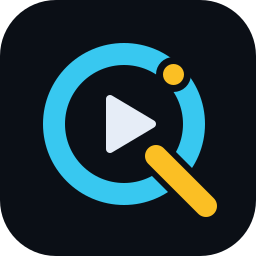

<p align="center"></p>

# QODA

**QODA**, QO-100 uydusundaki DATV (DVB-S2) yayınlarını izlemek için Rust ile yazılmış açık kaynak bir alıcıdır. Yaygın SDR alıcılarla spektrumu gösterir, içindeki yayınları bulur, seçilen yayını çözer ve videoyu oynatır.

Adı **QO**-100 ve **DA**TV'den gelir.

[English](README.md)

## Özellikler

- RTL-SDR, HackRF ve diğer alıcılarla SoapySDR üzerinden, ADALM-Pluto / LibreSDR ile doğrudan libiio üzerinden çalışır (RTL-SDR, HackRF One ve Ethernet üzerinden LibreSDR ile denendi)
- LNB lokal osilatörü ve yayın frekansı girilir; ara frekans hesaplanır ve alıcı otomatik ayarlanır
- Canlı spektrum ve şelale, görünen banttaki yayınların listelendiği bir şerit; gigabit Ethernet'teki Pluto/LibreSDR ile 12 MS/s'de geniş bant transponderinin (10491–10499.5 MHz) tamamı tek ekranda
- Kolay ayar: frekans rakamlarını tek tek tekerlekle ya da tıklayarak değiştirme, tekerlekle seçimi kaydırma, spektrumu sürükleyerek alıcıyı kaydırma
- Yayının sembol hızı, bant genişliği ve roll-off'unun spektrumdan otomatik tespiti
- ETSI EN 302 307-1 temel alınarak Rust ile sıfırdan yazılmış DVB-S2 çözücü: çerçeve senkronu, taşıyıcı ve zamanlama kurtarma, çerçeve başlığından MODCOD (modülasyon ve FEC), paralel LDPC ve BCH çözümü, MPEG-TS çıkışı
- Program içinde video ve ses
- DVB tablolarından servis adı, sağlayıcı ve akış türleri
- SigMF biçiminde ham IQ kaydı ve kayıtları çözen komut satırı aracı
- İngilizce ve Türkçe arayüz

Şu an QPSK yayınlar destekleniyor (pilotlu/pilotsuz, normal/kısa çerçeve). 8PSK/APSK modülasyonları ve BCH hata düzeltme sırada.

## Gereksinimler

- QO-100'e bakan bir çanak, LNB (yatay polarizasyon, 18 V) ve bir SDR alıcı. QO-100 DATV yayınları genelde 1.5 MS/s ve altında olduğu için RTL-SDR bile yeterli.
- [SoapySDR](https://github.com/pothosware/SoapySDR) ve alıcınızın sürücü modülü. Windows'ta en kolayı [PothosSDR](https://downloads.myriadrf.org/builds/PothosSDR/); `bin` klasörünü `PATH`'e ekleyin.
- Video ve ses için [FFmpeg](https://ffmpeg.org/) (`ffmpeg` ve `ffplay` `PATH`'te). Windows'ta: `winget install Gyan.FFmpeg`.

**Windows'ta RTL-SDR için not:** PothosSDR 2021 ile gelen eski `rtlsdr.dll` akış durdurulurken çökebiliyor. [RTL-SDR Blog sürümlerinden](https://github.com/rtlsdrblog/rtl-sdr-blog/releases) `x64` klasöründeki `rtlsdr.dll`, `pthreadVC2.dll` ve `msvcr100.dll` dosyalarını `qoda.exe`'nin yanına koyun.

## Derleme

```bash
cargo build --release
```

Program `target/release/qoda`, komut satırı aracı `target/release/qoda-analyze`'dır.

## Kullanım

1. Cihazı seçip **Alıcıyı başlat**'a basın. Ağdaki bir Pluto veya LibreSDR için cihaz listesinin altına IP adresini yazıp **Ekle**'ye basın; adres hatırlanır.
2. **LNB LO** (ör. 9750 MHz) ve **Merkez RF** frekansını girin; ara frekans altlarında görünür.
3. Spektrumda bir yayına tıklayın ya da üstteki **Yayınlar** şeridinden birini seçin. Sembol hızı ve roll-off tespit edilir, kapladığı bant vurgulanır. Çift tıklama alıcıyı o yayına ortalar.
4. **▶ İzle**'ye basın. Yayın canlı olarak çözülür; video spektrumun üstünde görünür, **İzleme** kartında kilit durumu, MODCOD, SNR, çerçeve sayaçları ve servis adı gösterilir.

Ayar:

- Frekans göstergelerinde bir rakamın üzerinde tekerlek o rakamı değiştirir; rakamın üst yarısına tıklamak artırır, alt yarısı azaltır.
- Spektrumda tekerlek seçimi 10 kHz (Shift ile 100 kHz) kaydırır; sürüklemek alıcıyı kaydırır.
- İzlerken çözücü, ayarları değiştirmeyi bıraktıktan yarım saniye sonra yeni ayarla yeniden başlar.

Arayüz dili sağ üstteki seçiciden değiştirilir. Dil ve LNB LO `%APPDATA%\QODA\settings.txt` (Linux'ta `~/.config/qoda/settings.txt`) dosyasında saklanır.

### Kayıtlar

**IQ kaydet** ham örnekleri `recordings` klasörüne SigMF (`.sigmf-data` ve `.sigmf-meta`) olarak kaydeder. Kayıt çevrimdışı çözülebilir:

```bash
qoda-analyze recordings/<ad>
```

`--scan` kayıttaki bütün yayınları listeler; `--freq MHz` ortada olmayan bir yayını seçer. Tespit edilen parametreleri, her çerçeve başlığını, hata düzeltme sonuçlarını ve servis bilgisini yazdırır, taşıma akışını kaydın yanına `.ts` dosyası olarak yazar. Seçenekler: `--seconds S`, `--rs kS/s`, `--rolloff R`, `--stream` (canlı görünümdekiyle aynı akış alıcısıyla çöz) ve `--noise dB` (zayıf sinyal alımını sınamak için beyaz gürültü ekle).

## Nasıl çalışır

```
SDR ─► frekans kaydırma ─► seyreltme ─► RRC eşleştirilmiş filtre ─► Gardner zamanlama ─► PL başlık senkronu (SOF + PLS)
    ─► karıştırma çözümü + taşıyıcı PLL ─► QPSK yumuşak demap ─► LDPC (paralel) ─► BCH ─► BBFRAME ─► MPEG-TS
    ─► ffmpeg (video) / ffplay (ses)
```

LDPC tabloları ve BCH polinomları standardın metninden `tools/gen_ldpc_tables.py` ile üretildi; standardın PDF'i repoda yer almaz.

## Lisans

GPL-3.0-or-later. Ayrıntılar için [LICENSE](LICENSE).

## Katkıda bulunanlar

QODA, **yAtölye** (yeniden atölye) çalışma grubu tarafından geliştirilmektedir.
